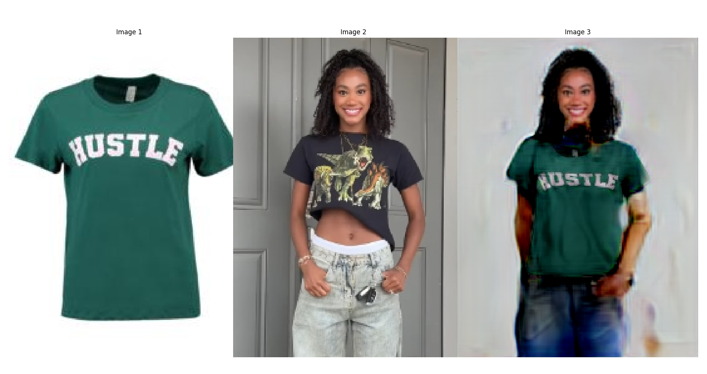

# TritonViton

<p align="center">
  
  <br>
  <em>Figure: Example of try on</em>
</p>

## 0. Pre Setup
- Download the [model](https://drive.google.com/file/d/1KsP2dHplcuQ5b09KCm9FbIFDQpHuLpda/view?usp=drive_link)
- Unzip it into current directory 
```bash
wget -O models.zip "https://drive.google.com/uc?export=download&id=1KsP2dHplcuQ5b09KCm9FbIFDQpHuLpda"
unzip models.zip
rm models.zip
```
All the directory should be looking like:
- `data/` — All the data, include inputa and output
- `humanParser/` — Human parsing module or scripts  
- `models/` — All the weights for all the models 
  - `human_parsing/` — Models related to human parsing  
  - `pose_estimation/` — Models for pose estimation  
  - `tryon/` — Models for virtual try-on   
- `networks/`: All the files for human parsing model
- `openpose/`: All the files for pose estimation model (openpose)
- `TryOnNets.py`: All the Arhitecture of our main try on network
- `uitls.py`: All the utils function
- `inference.py`: The main python file for running the model
- `Dockerfile`: The docker file to build the docker image
- `requirements.txt`: Requirements for building the virtual environment


## 1. Create Virtual Env

Suggestion environment info:
- os: Ubuntu 22.04
- python: 3.8.0
- cuda: 12.4 
- gcc: 10.5
- g++: 10.5

```bash
conda create --name tryon_env --file requirements.txt
```

NOTES:
1. If you are using windows I suggest you to run on docker, check part-3 to run with docker

3. Check your cuda version, make sure pytorch support your cuda
    - check cuda version: 
    ```bash
    nvcc --version && nvidia-smi
    ```
    - check pytorch: (in .py file)
    ```python
    print(torch.version.cuda)`
    ```
   
4. gcc and g++ version, make sure both are 10.5
    - check version: 
    ```bash
    gcc --version && g++ --version
    ```
    - install gcc 10 and g++ 10 if you are using other version: 
    ```bash
    sudo apt install gcc-10 g++-10
    ```
    - change the environment variable: 
    ```bash
    export CC=gcc-10 && export CXX=g++-10
    ```
    you can put this line in your `~/.bashrc` so you need to run it everytime you open the terminal


## 2. Run our model
If you want to test with image put your test cloth image in `data/input/cloth`, test person image in `data/input/image` make sure both are .jpg files
If you want to test with video, put your person video input  in `data/input/video`, make sure is .mp4 file

Both result will store under `data/output` in either .jpg or .mp4

WARNING: Image or video size should be at least height*width = 256*196
1. Test image inference mode: 
```bash
python inference.py --mode image --person <image name> --cloth <cloth name>
```
- Example: 
```bash
python inference.py --mode image --person 1 --cloth 5
```

2. Test video inference mode:
```bash
python inference.py --mode video --person <image name> --cloth <cloth name>`
```
- Example: 
```bash
python inference.py --mode video --person 1 --cloth 5
```


## 3. Docker:
- If you are using window, make sure you installed WSL2 and docker desktop before you start it
- If you are using MacOS, sadly since this need Nvidia GPU, it does not support 

1. Build docker image: 
```bash
docker build -t tv_image:latest .
```
2. Execute in docker normally: 
```bash
docker run --gpus all -it --rm tv_image:latest
```
3. Execute in docker with GUI: 
```bash
docker run -it --rm \
                --gpus all \
                -e DISPLAY=$DISPLAY \
                -v /tmp/.X11-unix:/tmp/.X11-unix \
                tv_image:latest
```


